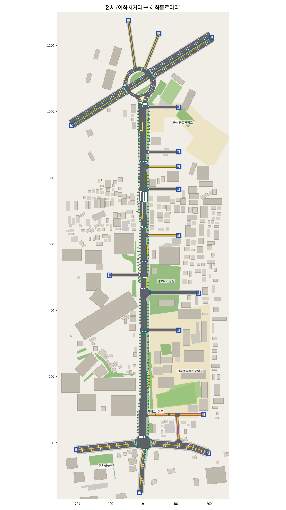
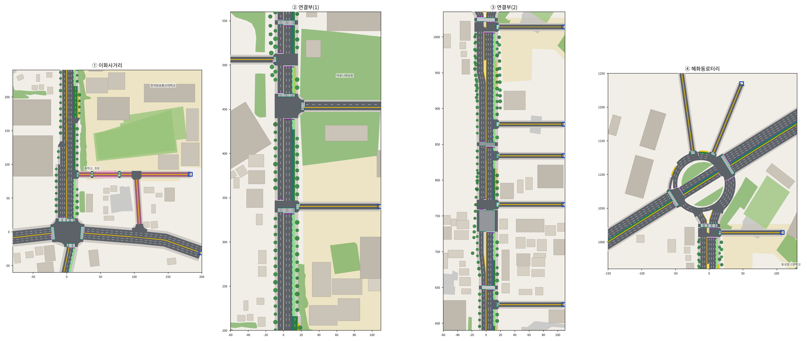
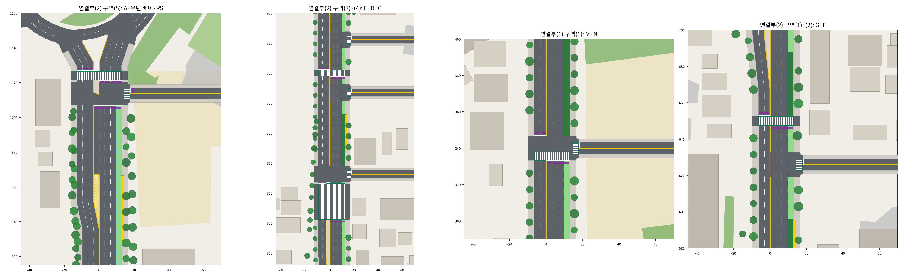
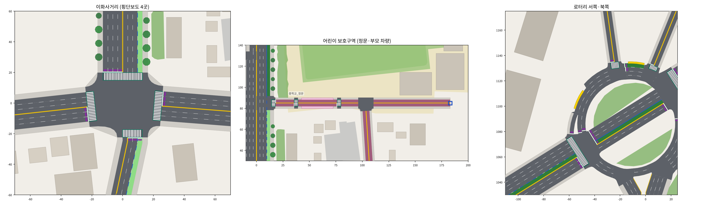

# 대학로 SUMO 도로 (이화사거리 → 혜화동로터리) — v3

팀 그림("도로그림" 공통기호 + ①~④ 상세도, "수정부분1", "3-구역(3),(4),(5) 도로그림")을 SUMO 도로로 옮긴 것이다.
지금은 **일반 차량(버스 + 버스가 아닌 차 + 부모 차량)과 보행자**만 다닌다. 학습한 자율주행차는 맨 아래 "다음 단계" 참고.



## 1. 실행

```bash
python view_daehakro.py                  # sumo-gui로 열기 (▶ 버튼으로 재생)
python view_daehakro.py --nogui          # 화면 없이 1시간 돌리고 점검표 출력 (차량·버스전용차로·유턴·보행자)
python view_daehakro.py --nogui --seed 7 # 다른 난수로 점검
python view_daehakro.py --plot           # 도로망 그림(PNG) 저장 (matplotlib 필요)
python utils/plot_daehakro.py --snapshot 1500   # 1500초 시점의 차량·보행자까지 그림
python view_daehakro.py --netedit        # netedit로 도로망 보기
```

- 실행할 때마다 `env/daehakro_config.py`를 읽어 `env/sumo/daehakro/` 안의 SUMO 파일을 **새로 만든다**.
  도로·신호·교통량을 바꾸려면 config 파일만 고치면 된다.
- SUMO 1.27.1에서 만들고 시험했다. 1시간 시뮬레이션은 화면 없이 30초 안팎(점검표 포함 1~2분).
- sumo-gui는 `daehakro.sumocfg`로 열어야 아래 화면 설정(`daehakro.gui.xml`)이 함께 적용된다.
- 수업 기본 코드(`road_builder.py`, `view_road.py`, `env/sumo_env.py`)는 건드리지 않았다.

## 2. v3에서 고친 것 (피드백 항목별)

### 공통: "교차로가 아닌 곳에서 중앙선·차선이 끊김", "버스차로 실선↔점선 경계의 기호"
SUMO는 노드(교차로)마다 교차로 면을 깔고 그 안에는 차선을 그리지 않으며, sumo-gui는 모든 차로 끝에 정지선 모양 막대를
그린다. v2는 북행·남행이 한 노드를 같이 써서, 옆길 하나·버스차로 경계 하나만 있어도 도로 전체가 끊겨 보였다. v3는:

- **한쪽 방향만 나눔**: 우회전 진출입만 있는 동쪽 옆길(이화장길 입구, G, B, C 입구), 버스차로 점선/실선 경계, 버스 베이 앞뒤,
  유턴 베이 시작은 **북행만**, 이화사거리 앞 남행 차로가 늘어나는 곳(SB3·SB2)은 **남행만** 노드를 둔다.
  반대 방향 차로와 **중앙선은 한 줄로 이어진다**. 양방향을 같이 나누는 곳은 신호 횡단보도와 실제 교차로뿐이다
  (이화사거리, M, O, I, H, F, E, D, C, A, 로터리 남쪽).
- **면적 없는 노드**: 버스차로 점선↔실선 경계(d427·d596·d688·d816)와 차로 수만 바뀌는 곳(SB3, 베이 끝, 유턴 베이 시작)은
  교차로 면이 0이라 차선이 그대로 이어진다.
- **정지선 막대 감춤**: `daehakro.gui.xml`에 `realisticLinkRules`를 켰다. 신호 없는 직진(우선 도로)에는 아무것도 안 그리고,
  양보해야 하는 곳은 흰 정지선, 신호는 신호 색으로만 보인다 → 버스차로 경계의 흰 막대가 사라진다.
- **교차로 면 위 차선**: 옆길 입구처럼 한쪽만 나뉜 곳은 교차로 면 위에도 차선(흰 점선)·버스차로 선(파랑)을 이어 그렸다
  (`daehakro.deco.xml`, sumo-gui와 PNG 모두).

### 1. 이화사거리
- **구역(1)** 율곡로 서행 → 학교 앞 남쪽 골목 우회전(어린이 보호구역 진입): 10 → **60대/시** (+ 부모 차량 12대/시).
- **구역(2)** 이화장길 동쪽 끝에서 나오는 차: 55 → **105대/시** + 부모 차량 22대/시 = **127대/시**.
  대학로 북쪽으로 가는 차(70)는 이화장길 입구에서 우회전, 율곡로 쪽으로 가는 차(35)는 남쪽 골목으로 나간다.
  (이화장길 입구 출구는 대학로 북행 차의 틈을 기다려야 해서, 이보다 많으면 정문 앞까지 줄이 늘 서 있게 된다)
- **구역(3)** 신호③(율곡로 서행 직진) 43초 → **34초**. 신호 ① 34 · ② 29 · ③ 34 · ④ 29초 (150초 주기).
- **구역(4)** 이화장길 입구~버스 베이: 이화장길 입구·베이는 북행만, 남행 차로가 늘어나는 두 곳은 남행만 나눔 → 중앙선 이어짐.
- **구역(5)** 학교 앞 골목: 율곡로 **서행만** 나눔(골목이 북쪽이라 동행은 이어짐). 골목에서 나오는 차는 정지선에서
  율곡로 서행의 틈을 기다렸다가 합류.
- **기타(2) 횡단보도 4갈래**: 동·서·남쪽 횡단보도를 추가했다. 방향별 단독 신호라, 각 횡단보도는 그 갈래로 **우회전만**
  들어가는 신호 때 보행 녹색이다(그 신호의 직진·좌회전은 그 횡단보도를 지나지 않음).

  | 신호 | 진입 | 보행 녹색 횡단보도 | 그 신호의 우회전 |
  |---|---|---|---|
  | ① 34초 | 율곡로 서쪽 | 남쪽 | 보행 녹색 처음 4초 정지 → 보행자 양보하며 진행 |
  | ② 29초 | 대학로 남쪽 | 동쪽 | 〃 |
  | ③ 34초 | 율곡로 동쪽 | 북쪽 | 〃 |
  | ④ 29초 | 대학로 북쪽 | 서쪽 | 〃 |

  보행 녹색은 신호 시작 7초 뒤(앞 신호에 들어온 버스가 교차로 건너편 횡단보도까지 빠져나갈 시간)부터.
  적색 우회전은 일시정지 후 허용하되, 자기 갈래 횡단보도가 보행 녹색인 신호와 녹색 차와 같은 차로로 합류하게 되는
  신호 동안은 금지. 좌회전·유턴은 녹색 끝 3초 전에 먼저 황색, 전적색 3초(교차로가 커서 늦게 들어간 차가 빠져나가게).
  율곡로 동쪽에서 북쪽으로 우회전하는 차는 이화장길로 갈 차만 버스차로(점선)로, 나머지는 바로 2차로로 들어간다.
- **하교 시간 어린이 보호구역**
  - **부모 차량** 68대/시 (분홍): 어린이 보호구역에 들어오면 처음부터 약 15km/h로 천천히 달리다가 **중학교 정문 앞 길가**
    (정문 쪽·길 건너 각 5대)에 **40·60·80초** 멈춰 아이를 태우고 떠난다. 급정거 없이 서서히 멈춤.
    출발·도착: 율곡로 서행→골목→정문→대학로 북쪽, 이화장길 동쪽 끝→정문→대학로 북쪽,
    율곡로·대학로 남쪽·로터리 쪽→이화장길 입구→정문(길 건너)→이화장길 동쪽 끝/골목.
    아이를 태운 뒤 서행 차로에 줄이 서 있으면 틈이 날 때까지 기다렸다 나간다(검증 1,007번 정차 중 1분 넘게 기다린 것 13번).
  - **중학교 정문에서 하교하는 학생** 500명/시 (주황, 천천히 걷기): 율곡로·대학로 남쪽·대학로 북쪽·골목·이화장길 동쪽·
    길 건너로 흩어진다. 정문 앞에 **신호 없는 횡단보도**(보행자 우선)를 두어 길 건너로 가는 학생이 거기서 건넌다.
    T자 서쪽 횡단보도는 T에서 25m 떨어진 곳에 두어 차가 T 교차로 안이 아니라 횡단보도 바로 앞에서 양보한다.
  - 어린이 보호구역을 지나가는 차는 경로를 **제한속도 기준 최단 시간**으로 정해, 율곡로→대학로 차가 골목·이화장길을
    지름길로 쓰지 않는다(그 지역에 볼일 있는 차만 들어감).
  - **이화장길 입구에서 나오는 차**는 실제 운전자처럼 자기가 건너는 버스차로와 합류하는 2차로의 차, 그리고 횡단보도
    보행자만 보고 나간다. (SUMO 기본은 대학로 북행 4개 차로 모두에 양보 → 출구가 거의 열리지 않아 정문 앞까지 줄이 서고,
    길가에 선 부모 차량이 아이를 태운 뒤 몇 분씩 다시 출발하지 못했다. builder가 이 교차로에만 차로별 양보를 적용)

### 2. 연결부(1)
- **구역(1)** M 횡단보도와 바로 북쪽 옆길 N을 **한 교차로**로: 남행 신호(정지선)는 **N 입구 북쪽**, 그 사이는 교차로 안
  (그림 ② 점선 부분). 북행 정지선은 횡단보도 바로 남쪽. N 입구 횡단보도는 신호 없음(보행자 우선).
- **구역(2)** 버스차로 점선↔실선 경계: 북행만 나뉘는 면적 0 노드 + 정지선 막대 감춤 → 아무 표시 없음 (같은 곳 모두: d427, d596, d688, d816).
- **구역(3)** I의 북행 1차로 = **좌회전 전용**(I 북쪽 4번째 차로는 2차로 직진 차가 나눠 씀). 좌회전은 **보호 좌회전만**
  (옆길 I 녹색 때, 비보호 없음) → 교차로 안에서 기다리는 차가 없어 꼬리물기가 생기지 않는다. 좌회전 교통량 25 → 20대/시.

### 3. 연결부(2)
- **구역(1)** G: 우회전 진출입만 있어 **북행만** 나눔 → 남행·중앙선 이어짐. 정류장 끝 버스차로 경계(d596)는 표시 없음.
- **구역(2)** d688: 연결부(1) 구역(2)와 같은 방식.
- **구역(3)** 새 그림대로: 깊이 **30m** E 횡단보도 바로 북쪽에 옆길 D. 남행 3차로 중 안쪽 차로는 D에서 **좌회전·유턴 전용**으로
  끝나고, 그 자리는 **섬**이 되어 횡단보도 남쪽 30m까지 이어진 뒤 30m에 걸쳐 남행 차로가 한 차로만큼 비켜 원래 자리로 돌아온다.
  남행 직진 정지선 = 횡단보도 바로 북쪽, 북행 정지선 = 횡단보도 바로 남쪽. D의 좌회전·유턴만 신호(E 보행 신호 때), 나머지는 신호 없음.
- **구역(4)** 새 그림대로: C 횡단보도(신호) 바로 남쪽에 C 옆길 입구. **북행 정지선은 C 입구와 횡단보도 사이**,
  남행 정지선은 횡단보도 북쪽. C 입구는 북행만 나눔.
- **구역(5)** 새 그림대로: 로터리 남쪽 횡단보도 **북쪽에 남행 신호**, 횡단보도 남쪽에 옆길 A 입구, **A 입구 남쪽 모서리에 북행 정지선**
  (유턴 베이 포함). 정지선 북쪽은 섬, 유턴은 섬 남쪽 끝을 돌아 (로터리 남쪽 보행 신호 때). 그 남쪽으로 **유턴 베이 40m** →
  **빗금 도류화 15m** → 16m에 걸쳐 남행 차로가 비켜 이어짐(중앙선 끊기지 않음). 정류장(40m)은 A 남쪽 모서리에서 40m 떨어져 끝남.
  A는 우회전 진출입만 있어 횡단보도 앞을 교차로처럼 만들지 않았다(A 출구 차는 앞 횡단보도 신호에 맞춰 나감).

### 4. 혜화동로터리
- **구역(1)** 대학로 남행 출구 ~ 대학로 북행 진입 사이 회전 차로 **2차로**.
- **구역(2)** 서쪽 가장 바깥 차로: 버스 전용 → **일반 차로**. 가장 바깥(4번째) 차로는 우회전 차로가 갈라지기 약 25m 앞에서
  **3번째 차로와 합쳐지고**, 합쳐진 차로가 남서쪽 우회전 차로(한 차로)가 된다. 정류장은 합쳐진 바깥 차로 끝.
- **구역(3)** 혜화로 앞: **신호는 혜화로로 나가는 차(우회전)와 들어오는 차만**, 안쪽 2차로는 신호 없이 회전. 3번째 차로 = 혜화로 **우회전 전용**.

### 5. 기타
- **(1) 건물**: 70㎡보다 작은 건물은 빼고, 나머지는 **도로 방향에 맞춘 반듯한 직사각형**(ㄱ·ㄷ자는 실제 넓이에 가깝게 줄임),
  건물 사이 2m 간격, 겹치는 건물 제거, 색 3가지 → 482동 → 322동. (지도 데이터 © OpenStreetMap contributors, ODbL)
- **(2)** 이화사거리 4갈래 횡단보도 (위 1장).

## 3. 파일

| 파일 | 내용 |
|---|---|
| `env/daehakro_config.py` | **모든 값**: 측점(그림의 거리), 차로, 버스전용차로 구간, 신호, 차종, 오후 3시 교통량, 부모 차량, 보행자 |
| `env/daehakro_builder.py` | config → SUMO 파일 생성 (도로망, 신호, 정류장·정차 공간, 차량·보행자 수요) |
| `env/daehakro_deco.py` | 건물·나무·버스차로 표시선·교차로 면 차선·섬·어린이 보호구역 노면 (`daehakro.deco.xml`, 화면용) |
| `env/data/daehakro_osm.txt` | 건물·나무용 OpenStreetMap 추출 데이터 |
| `view_daehakro.py` | GUI 실행 / 1시간 점검표 / 그림 저장 |
| `utils/plot_daehakro.py` | 도로망 PNG (전체·구간별·확대 두 장, `--snapshot`으로 차량·보행자 포함) |
| `env/sumo/daehakro/` | 만들어진 SUMO 파일 (`daehakro.sumocfg`로 바로 열 수 있음) |

그림 색(도로그림 공통기호와 맞춤): 연두 버스전용 점선 · 진녹색 버스전용 실선 · 파란 선 노면 버스차로 표시 ·
노란 선 중앙선 · 흰 줄무늬+청록 테두리 횡단보도 · 보라 막대 차량 신호등 · 흰 굵은 선 정지선 · 노랑 정류장 ·
분홍 점선 상자 부모 차량 정차 공간 · 회색+노란 테두리 섬 · 빗금 도류화 · 파란 네모 차량 생성/소멸 · 분홍 어린이 보호구역 ·
회색 보도 · 베이지 건물 · 초록 공원/가로수. 스냅샷: 흰 사각형 승용차, 분홍 부모 차량, 파랑 버스, 빨간 점 보행자.





## 4. 요구사항별 내용

- **도로**: 이화사거리 4갈래(신호 ①~④, 그림의 차로별 화살표, 횡단보도 4곳), 대학로 본선(그림 거리 누적, 북행 버스베이·유턴베이),
  옆길 동쪽 N·O·G·D·C·B·A·서쪽 I, 이화장길(어린이 보호구역, 정문 앞 횡단보도), 혜화동로터리(반시계 회전 차로 + 창경궁로 축 + 갈래 7개).
- **차종**: 버스(대학로 북행 117대/시, 정류장 5곳 20초 정차 / 남행 23 / 로터리 서쪽 정류장 노선 12 / 창경궁로 중앙차로 100),
  승용차(운전 모델 Krauss 35% · IDM 30% · EIDM 20% · ACC 15%, 수업 환경과 같은 비율), 부모 차량 68대/시.
- **교통량(평일 15~16시, 2025 서울시 교통량 조사)**: 모델에서 같은 단면을 다시 센 값(버스 포함, 계획 대/시)

| 지점 | 통계 | 모델 |
|---|---|---|
| A-07 대학로 북행 / 남행 | 1,306 / 754 | 1,287 / 765 |
| A-06 창경궁로 로터리 쪽 / 반대쪽 | 922 / 1,017 | 925 / 1,012 |
| A-05 율곡로 동행 / 서행 (1.5km 떨어진 다른 지점) | 1,420 / 1,365 | 약 72% (이화사거리 용량) |

- **속도**: 어린이 보호구역 30km/h(부모 차량은 정문까지 약 15km/h), 나머지 50km/h.
- **교통법규**: 적색 우회전은 일시정지 후 진행(보행자 양보), 교차로 안 진로변경 금지, 유턴은 그림 표시 지점만,
  **꼬리물기 금지**(앞이 막혀 기다려야 하면 교차로 안으로 들어가지 않고 정지선에서 대기),
  비보호 좌회전·유턴·옆길 진출은 우선 차량에 양보(최소 간격 2초), 황색 3초 + 전적색 2초(이화사거리 3초),
  신호 없는 횡단보도 보행자 우선(횡단보도 쪽으로 15m 안에 걸어오는 보행자가 있으면 출발하지 않음).

## 5. 검증 결과 (`--nogui`, seed 1~16, 각 1시간)

| seed | 투입(대) | 투입 대기 | 텔레포트 | 충돌 차-차 / 차-보행자 | 통행 평균 속도 | 부모 차량 정차 | 재출발 대기 중앙값 / 최대 | 3분 넘게 멈춘 차 |
|---|---|---|---|---|---|---|---|---|
| 1 | 5,460 | 1 | 0 | 0 / 1 | 19.3 km/h | 57대 | 0초 / 52초 | 0 |
| 2 | 5,536 | 7 | 0 | 0 / 0 | 17.9 km/h | 57대 | 0초 / 160초 | 0 |
| 3 | 5,653 | 6 | 0 | 0 / 1 | 18.1 km/h | 49대 | 0초 / 16초 | 0 |
| 4 | 5,613 | 8 | 0 | 0 / 0 | 18.7 km/h | 66대 | 0초 / 324초 | 0 |
| 5 | 5,563 | 19 | 0 | 0 / 0 | 18.3 km/h | 58대 | 0초 / 29초 | 0 |
| 6 | 5,484 | 7 | 0 | 0 / 0 | 18.6 km/h | 71대 | 0초 / 8초 | 0 |
| 7 | 5,578 | 4 | 0 | 0 / 0 | 18.4 km/h | 58대 | 0초 / 18초 | 0 |
| 8 | 5,644 | 42 | 0 | 1 / 1 | 17.8 km/h | 76대 | 0초 / 90초 | 0 |
| 9 | 5,625 | 25 | 0 | 0 / 0 | 18.7 km/h | 72대 | 0초 / 49초 | 0 |
| 10 | 5,505 | 0 | 0 | 0 / 0 | 18.9 km/h | 64대 | 0초 / 80초 | 0 |
| 11 | 5,648 | 1 | 0 | 0 / 2 | 18.2 km/h | 59대 | 0초 / 63초 | 0 |
| 12 | 5,690 | 10 | 0 | 0 / 5 | 18.3 km/h | 57대 | 0초 / 14초 | 0 |
| 13 | 5,638 | 23 | 0 | 0 / 2 | 18.0 km/h | 69대 | 0초 / 74초 | 0 |
| 14 | 5,648 | 21 | 0 | 0 / 3 | 17.8 km/h | 70대 | 0초 / 42초 | 0 |
| 15 | 5,657 | 34 | 0 | 0 / 0 | 17.8 km/h | 65대 | 0초 / 316초 | 0 |
| 16 | 5,537 | 0 | 0 | 0 / 1 | 18.1 km/h | 59대 | 0초 / 28초 | 0 |
| **합계·평균** | 5,592 | 13 | 0 | 1 / 16 | 18.3 km/h | 63대 | 0초 / 324초 | 0 |

- 16개 seed 모두 **텔레포트 0회, 3분 넘게 계속 멈춘 차 0대** → `view_daehakro.py --nogui` 판정 "정상".
  기본 seed 42도 텔레포트 0 · 충돌 0 · 부모 차량 61대 정차(재출발 대기 최대 84초).
- 충돌 기록은 16시간에 17건(시간당 약 1건, 한 seed 최대 5건), 차-차는 1건뿐이고 나머지는 보행자 접촉.
- 부모 차량 재출발 대기: 정차 1,007번 중 994번은 1분 안에 다시 출발. 길게 기다린 경우(최대 5분 남짓)는 차가 많은 seed에서
  이화장길 입구 출구에 줄이 정문 앞까지 섰을 때다.
- 투입 대기 = 1시간 끝에 출발 시각이 됐지만 아직 도로에 들어오지 못한 차 (seed 42는 율곡로 서쪽 끝 2대: 이화사거리 ① 신호 대기 줄).

충돌 기록은 SUMO의 판정 한계로 생기는 드문 "접촉"이다(신호 없는 횡단보도에서 막 들어선 보행자와 차 모서리, 긴 버스가
모퉁이에서 기다리는 보행자 옆을 지날 때 등). `collision.action=warn`이라 시뮬레이션은 그대로 진행되고, 수업 환경(`sumo_env.py`)은
교차로 겹침 검사를 하지 않는다.

## 6. 신호 현시

| 신호 | 주기 | 녹색(초) |
|---|---|---|
| 이화사거리 | 150 | ①율곡로 서쪽 34(남쪽 횡단보도 보행 12+11) · ②대학로 남쪽 29(동쪽 6+16) · ③율곡로 동쪽 34(북쪽 6+21) · ④대학로 북쪽 29(서쪽 6+16) |
| 횡단보도 M·H·F | 150 | 차량 115 · 보행 14+16(녹색+점멸), 북행 12m/s로 연동 |
| E(깊이 30m) / C | 150 | 차량 115 · 보행 12+18 |
| D | 150 | 남행 좌회전·유턴 22 (E 보행 녹색 시작 4초 뒤 ~ 끝나기 4초 전) |
| 옆길 O | 150 | 본선 89(끝 6초는 O 입구 보행 적색) · 옆길 18 · K 보행 14+16. O에서 나오는 우회전은 본선 끝 6초와 K 보행 점멸 후반 8초에도 일시정지 후 진행 |
| 옆길 I | 150 | 본선 120 · 옆길 우회전 진출 + 북행 보호 좌회전 20 |
| 로터리 J_NE / J_SW | 75 | 회전 20 + 회전·보행 22 · 창경궁로 18 / 회전·보행 35 · 창경궁로 30 |
| 로터리 남쪽 RS / A | 75 | 북행·남행 42 · 보행 7+21 / A 북행 41(RS보다 2초 먼저 시작, 3초 먼저 끝) · 유턴 20(RS 보행 때) |
| 혜화로 (J_NW) | 75 | 혜화로 진출·진입 55 · 보행 9+6 (안쪽 회전 2차로는 신호 없음) |

## 7. 그림·실제와 다른 점

| 무엇 | 어떻게 | 이유 |
|---|---|---|
| 구역(3) 남행 정지선 | 직진은 횡단보도 바로 북쪽(그림대로), D 좌회전·유턴 차로 정지선은 D 입구 북쪽 | SUMO는 정지선이 교차로 경계에만 올 수 있어, D 입구와 횡단보도를 1m 사이로 붙인 두 교차로로 만듦 |
| 구역(4) 북행 정지선 | C 입구와 횡단보도 사이에 7m (그림은 바로 붙음) | 신호 대기 맨 앞 차가 C 입구 교차로에 걸치지 않고, C에서 나오는 차가 횡단보도 위에서 서지 않게 |
| 유턴 베이·남행 비켜 이어짐 | 유턴 베이는 경사 없이 시작, 남행 차로는 16m 경사 | SUMO 차로는 폭이 일정해 베이 앞 경사를 그릴 수 없음 (빗금 도류화는 화면에 그림) |
| 이화사거리 남쪽 갈래 | 교차로 앞 25m는 북쪽 갈래와 같은 방향 | 버스차로가 북쪽 버스차로와 일직선 → 버스가 비스듬히 지나며 모퉁이 대기 보행자를 스치지 않음 |
| 정문 앞 횡단보도 | 그림에 없음 | 하교 학생 500명/시가 길 건너로 갈 곳 (이화장길 입구 횡단보도에 몰리지 않게) |
| 로터리 크기 | 회전 차로 반지름 40m (실제 약 30m) | 갈래·정류장 사이에 차가 설 공간 확보 |
| 로터리 갈래 횡단보도(혜화로·35길) | 갈래 안쪽이 아니라 회전교차로 경계 | 횡단보도와 회전 차로 사이에 차가 서지 않게 |
| 옆길 I | K 횡단보도에서 약 40m (그림 30m) | 그 사이 정류장에 버스 2대가 서도록 |
| O 교차로 모서리 | 반지름 7m (이화사거리 8m) | 우회전 차가 횡단보도 대기 보행자 옆을 스치지 않게 |
| 이화사거리 남행 차로 늘어남 | 처음 늘어나는 곳은 바깥 차로가 두 갈래로 나뉨, 두 번째는 차로변경으로 진입 | 우회전·직진 차가 차로를 못 바꿔 남행 줄이 길어지던 문제 |
| 버스 베이 | 북행 버스는 모두 베이로 들어가 정차 후 옆 버스차로로 나옴 | 교차로 안에서 비스듬히 갈라지면 긴 버스끼리 겹침 |
| 남서쪽 중앙 버스차로 | 그림은 점선, 모델은 버스 전용(화면 표시는 점선) | 이 구간 안에 좌회전할 곳이 없어 일반 차가 들어갈 이유가 없음 |
| 버스정류장 길이 | 그림의 "5m" 표시 → 22~40m (버스 2~3대) | 시간당 100대 넘는 버스가 실제로 설 수 있게. 정류장 끝 위치는 그림대로 |
| 율곡로 교통량 | A-05의 약 72% | 1.5km 떨어진 지점 값이라 그대로 넣으면 이화사거리 용량 초과 |
| 신호 시간 | 실제 현시를 구할 수 없어 교통량으로 산정 | 위 6장 |
| 차로변경 | 순간 이동(SUMO 기본) | 2초에 걸쳐 바꾸는 설정은 로터리 북쪽 짧은 구간에서 충돌이 늘어 쓰지 않음 |

## 8. 값 바꾸는 법 (`env/daehakro_config.py`)

| 바꾸고 싶은 것 | 항목 |
|---|---|
| 속도 제한 | `SPEED` |
| 버스전용차로 끄기(21시 이후처럼) / 점선·실선 구간 | `BUS_LANE`, `BUS_LANE_SECTIONS` |
| 옆길·횡단보도 위치 | `STA` (측점, m), 유턴 베이·섬 길이 `UTURN`, `E_ISLAND` |
| 정류장 위치·길이, 정차 시간 | `NB_BUS_STOPS`, `BUS_DWELL` |
| 신호 시간 | `SIGNAL` (이화사거리 `ihwa_phases`, 보행 갈래 `ihwa_ped`) |
| 일반 차량 교통량 | `CAR_OD` (대/시) — 빌드할 때 A-07·A-06 단면 값과 어린이 보호구역 진출입이 다시 출력됨 |
| 부모 차량 (대수, 정차 시간, 정차 공간, 서행 속도) | `PARENT` |
| 버스 노선·배차 | `BUS_FLOWS` |
| 보행자 수 / 정문 하교 학생 | `PEDESTRIANS` / `GATE_PEDESTRIANS`, 보행자 양보 거리 `PED_LOOKAHEAD` |
| 꼬리물기 금지(정지선에서 대기) | `JUNCTION_ADVANCE` (0 = 정지선, 1 = SUMO 기본) |
| 옆길 출구 차로별 양보 적용 교차로 | builder의 `LANE_LEVEL_YIELD` (지금은 이화장길 입구만) |
| 건물 정리 정도 | `DECO` (`min_building_area`, `building_gap`) |
| 운전 모델 비율 | `CAR_TYPES` |
| 시뮬레이션 시간·seed | `SIM` |

값을 바꾼 뒤에는 `python view_daehakro.py --nogui`로 점검표의 판정이 "정상"인지 확인하면 된다.

## 9. 다음 단계: 학습한 자율주행차 넣기
- 경로는 그림의 "출발"(이화장길 동쪽 끝) → "끝"(로터리 남서쪽)으로 `EGO_ROUTE = ("SZ", "SW")`에 정해 두었다.
  이 경로(`r_ego`)와 빨간 `ego_type`은 `daehakro.rou.xml`에 이미 있다(보행자 양보 설정 포함). 이 경로는 v3의 정문 앞 횡단보도와
  부모 차량 정차 구간을 지나므로 어린이 보호구역 주행도 함께 시험할 수 있다.
- 수업 `env/sumo_env.py`는 직선 고속도로용이므로, 이 도로에서 쓰려면 sumocfg 경로와 ego 투입·관측(차로 수가 구간마다 다름,
  신호·교차로·보행자)을 이 도로에 맞게 바꿔야 한다. step 0.5초는 수업 환경과 같다.
